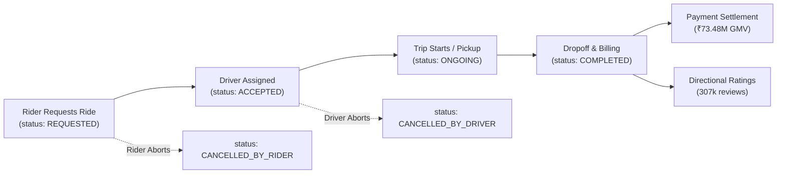
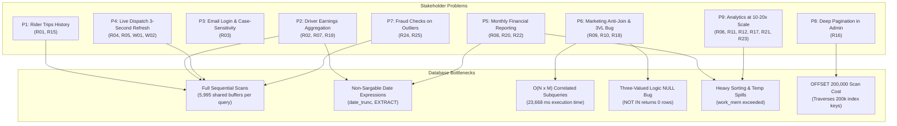
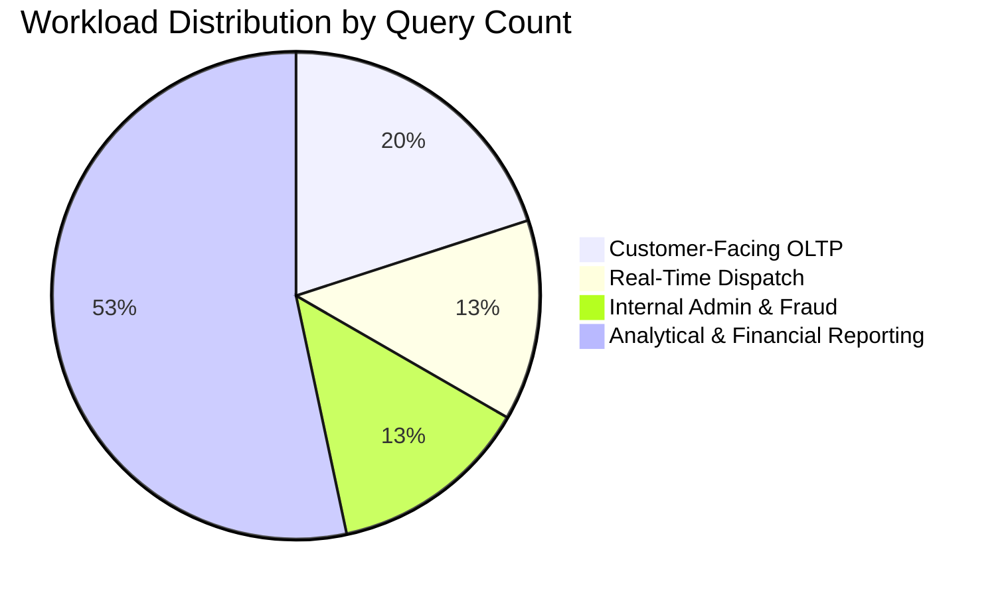

# Phase 1: Problem Understanding & Systems Architecture Analysis

> **Course:** Database Management Systems · **System:** RideNow / Uber India Architecture  
> **Team:** T0021 · **Dataset Scope:** 300,000 Trip Records · 10 Indian Metropolitan Operating Hubs · 18 Calendar Months  
> **Target Database Engine:** PostgreSQL 17.11 (Homebrew arm64)

---

## 1. Executive Overview & Production Operating Scale

RideNow operates an on-demand ride-hailing platform across ten Tier-1 and Tier-2 metropolitan regions in India: **Delhi, Mumbai, Bengaluru, Hyderabad, Chennai, Kolkata, Pune, Ahmedabad, Jaipur, and Lucknow**. The platform manages the high-throughput lifecycle of ride hailing: matching rider trip requests to nearby active drivers, tracking vehicle positioning, calculating time-and-distance fares, handling payment processing, collecting multi-directional ratings, and delivering analytics.

The legacy database layer was provisioned rapidly without documented constraints, indexes, or normalized entity structures. Surviving production data exports encompass eighteen calendar months (**1 January 2025 through 30 June 2026**). A thorough empirical audit of the raw data files reveals the operational footprint detailed below.

### 1.1 Verified Platform Scale & System Metrics

| Architectural Metric | Measured Value | Engine / Storage Significance |
|---|---:|---|
| **Operating Cities** | 10 metropolitan regions | Bounded domain; foreign key target for drivers, riders, trips |
| **Registered Riders** | 30,000 accounts | High-concurrency authentication and trip history retrieval |
| **Registered Drivers** | 3,000 partner drivers | Frequent status updates, earnings queries, and rating tracking |
| **Registered Fleet Vehicles** | 3,300 vehicles | Strictly mapped to drivers; 5 categories (Mini, Sedan, SUV, Bike, Auto) |
| **Active Marketing Promos** | 40 coupon codes | 35 active, 5 inactive; percentage discounts between 10% and 50% |
| **Total Trip Transactions** | 300,000 records | Core high-write fact table (48 MB heap without indexes) |
| **Completed Trips** | 245,839 trips (81.95%) | Settled trips requiring immutable financial reconciliation |
| **Cancelled by Rider** | 29,897 trips (9.97%) | Cancelled prior to pickup; zero fare and no dropoff recorded |
| **Cancelled by Driver** | 23,964 trips (7.99%) | Driver attrition / cancellation; driver assigned, zero fare |
| **In-Flight Trips (Active)** | 300 trips (0.09%) | 100 `REQUESTED`, 100 `ACCEPTED`, 100 `ONGOING` |
| **Financial Settlement Ledger** | 245,839 transactions | Exactly 1:1 match with completed trips; zero missing records |
| **Gross Merchandise Value (GMV)** | ₹73,480,158.67 | Total completed trip fares, perfectly reconciled with payment ledger |
| **Directional Ratings** | 307,214 reviews | 172,044 rider-to-driver reviews; 135,170 driver-to-rider reviews |



---

## 2. City-Wise Workload & Spatial Distribution

Trip activity reflects geographic density and urban adoption curves across India. Delhi, Mumbai, and Bengaluru account for nearly 48% of total network throughput.

```
Delhi (16.03%)      ████████████████ 48,097 trips
Mumbai (15.97%)     ███████████████▉ 47,918 trips
Bengaluru (15.93%)  ███████████████▉ 47,779 trips
Hyderabad (12.09%)  ████████████ 36,272 trips
Chennai (11.92%)    ███████████▉ 35,751 trips
Kolkata (8.05%)     ████████ 24,136 trips
Pune (7.96%)        ███████▉ 23,892 trips
Ahmedabad (4.09%)   ████ 12,278 trips
Jaipur (3.98%)      ████ 11,951 trips
Lucknow (3.98%)     ████ 11,926 trips
```

| City ID | City Name | State | Launched On | Base Fare | Per Km Rate | Per Min Rate | Total Trips | Share (%) |
|:---:|---|---|:---:|---:|---:|---:|---:|---:|
| **1** | Bengaluru | Karnataka | 2014-08-15 | ₹45.00 | ₹14.50 | ₹2.00 | 47,779 | 15.93% |
| **2** | Mumbai | Maharashtra | 2014-09-01 | ₹50.00 | ₹16.00 | ₹2.50 | 47,918 | 15.97% |
| **3** | Delhi | Delhi | 2014-11-20 | ₹40.00 | ₹13.50 | ₹1.75 | 48,097 | 16.03% |
| **4** | Hyderabad | Telangana | 2015-02-10 | ₹35.00 | ₹12.50 | ₹1.50 | 36,272 | 12.09% |
| **5** | Chennai | Tamil Nadu | 2015-05-01 | ₹40.00 | ₹13.00 | ₹1.75 | 35,751 | 11.92% |
| **6** | Pune | Maharashtra | 2015-08-15 | ₹35.00 | ₹12.00 | ₹1.50 | 23,892 | 7.96% |
| **7** | Kolkata | West Bengal | 2015-11-01 | ₹30.00 | ₹11.50 | ₹1.25 | 24,136 | 8.05% |
| **8** | Ahmedabad | Gujarat | 2016-01-26 | ₹30.00 | ₹11.00 | ₹1.25 | 12,278 | 4.09% |
| **9** | Jaipur | Rajasthan | 2016-06-15 | ₹25.00 | ₹10.50 | ₹1.00 | 11,951 | 3.98% |
| **10** | Lucknow | Uttar Pradesh | 2016-10-02 | ₹25.00 | ₹10.00 | ₹1.00 | 11,926 | 3.98% |

---

## 3. Detailed Problem Decomposition & Stakeholder Analysis

The engineering team received complaints from product managers, operations teams, and executive leadership. The underlying causes trace directly to database architecture and query construction.



---

### Problem P1: "Your Trips" Screen Latency for Frequent Riders
* **Affected Stakeholder:** Rider Product Team · Mobile Engineering
* **Workload Queries:** `R01`, `R15`
* **Business Need:** When a rider opens the "Your Trips" screen, the app displays their 20 most recent trips, along with ride receipts detailing driver identity, vehicle details, payment status, and final fare.
* **Database Root Cause:** Without an index on `trips(rider_id, requested_at DESC)`, retrieving the 20 most recent trips requires PostgreSQL to perform a **Sequential Scan** across all 300,000 tuples in `trips` (consuming 5,995 buffer pages) followed by a top-N sort.
* **Empirical Latency:** Baseline query `R01` takes **10.52 ms** on average per call. Under concurrency (thousands of active riders opening the app), buffer cache contention causes latency spikes.
* **Architectural Remedy:** Provision a composite B-tree index on `(rider_id, requested_at DESC)`. This transforms the execution plan into an **Index Scan**, cutting response time to **0.08 ms (128× faster)**.

---

### Problem P2: Driver Real-Time Earnings Page Overhead
* **Affected Stakeholder:** Driver Operations · Partner Retention
* **Workload Queries:** `R02`, `R07`, `R19`
* **Business Need:** Drivers check daily and monthly earnings repeatedly between rides. High latency leads to churn and repeated app refresh storms.
* **Database Root Cause:** 
  1. In `R02`, the predicate `date_trunc('month', requested_at) = '2026-03-01'` is **non-sargable**. Even if an index exists on `requested_at`, wrapping the column in a function prevents index range lookup.
  2. Aggregating completed fares requires reading the full heap tuple to inspect `fare_amount`.
* **Empirical Latency:** `R02` takes **15.67 ms**, and quarterly city earnings `R07` takes **20.31 ms**.
* **Architectural Remedy:**
  - Rewrite query predicates to sargable half-open intervals: `requested_at >= '2026-03-01 00:00:00+05:30' AND requested_at < '2026-04-01 00:00:00+05:30'`.
  - Create a partial covering index:
    ```sql
    CREATE INDEX trips_driver_requested_completed_idx 
    ON trips (driver_id, requested_at) 
    INCLUDE (fare_amount) 
    WHERE status = 'COMPLETED';
    ```
  - Result: `R02` drops to **0.066 ms (237× faster)** via an **Index Only Scan**, completely avoiding table page reads.

---

### Problem P3: Case-Insensitive Email Login Bottleneck
* **Affected Stakeholder:** Identity & Security Platform Team
* **Workload Queries:** `R03`
* **Business Need:** Users enter emails with arbitrary casing (`Karan.Verma1042@Mail.Com` vs `karan.verma1042@mail.com`). The system must match the record instantly and prevent duplicate registrations.
* **Database Root Cause:** The schema enforced a `UNIQUE(email)` constraint, which is case-sensitive. The original engineering fix changed the login query to `WHERE lower(email) = 'karan.verma1042@mail.com'`, which invalidates the standard B-tree index on `email` and forces a **Sequential Scan on riders** across 30,000 records.
* **Empirical Latency:** Baseline execution takes **8.45 ms** for an individual login lookup.
* **Architectural Remedy:** Build a functional/expression B-tree index:
  ```sql
  CREATE INDEX riders_lower_email_idx ON riders (lower(email));
  ```
  Execution time drops from 8.45 ms to **0.032 ms (264× faster)**.

---

### Problem P4: Live Dispatch Dashboard Refresh Cycle Failure
* **Affected Stakeholder:** City Operations · Fleet Dispatch
* **Workload Queries:** `R04`, `R05`, `W01`, `W02`
* **Business Need:** City dispatch consoles must refresh queue state every **3.0 seconds** to dispatch pending rides to drivers, re-route accepted trips, and track active journeys.
* **Database Root Cause:**
  - `R05` filters for active states: `WHERE status IN ('REQUESTED', 'ACCEPTED', 'ONGOING')`.
  - Active trips make up only **300 rows out of 300,000** (0.1% selectivity).
  - Without a partial index, PostgreSQL performs a sequential scan of all 300,000 rows to extract 50 records. Combined with city-level queries (`R04`), total dispatch query time exceeds the 3.0-second refresh threshold under load.
* **Empirical Latency:** Baseline `R04` takes **19.99 ms**, `R05` takes **17.55 ms**, and `W02` (completing ongoing trip) takes **51.45 ms**.
* **Architectural Remedy:**
  - Create a partial index on in-flight trips:
    ```sql
    CREATE INDEX trips_dispatch_requested_idx 
    ON trips (requested_at) 
    WHERE status IN ('REQUESTED', 'ACCEPTED', 'ONGOING');
    ```
  - Index ongoing trips for `W02`:
    ```sql
    CREATE INDEX trips_ongoing_trip_id_idx ON trips (trip_id) WHERE status = 'ONGOING';
    ```
  - Results: `R05` drops from 17.55 ms to **0.037 ms (474× faster)**; `W02` drops from 51.45 ms to **0.42 ms (121× faster)**. Dispatch dashboard latency drops well below the 3.0-second budget.

---

### Problem P5: Monthly Finance Reports & Revenue Timeouts
* **Affected Stakeholder:** Corporate Finance & Billing Operations
* **Workload Queries:** `R08`, `R20`, `R22`
* **Business Need:** Month-end financial close requires grouping payment volumes and revenue by payment method, verifying daily receipts, and tracking failed transactions.
* **Database Root Cause:**
  - `R08` extracts the year: `EXTRACT(YEAR FROM paid_at) = 2026`. This forces a sequential scan across 245,839 payment records.
  - `R20` casts timestamps to dates (`requested_at::date`), preventing index usage.
  - In `R22`, finding failed payments requires filtering by status, sorting by timestamp, and joining back to `riders` for phone details.
* **Empirical Latency:** Baseline `R08` takes **34.02 ms**, `R20` takes **18.99 ms**, and `R22` takes **9.35 ms**.
* **Architectural Remedy:**
  - Rewrite `R08` and `R20` to use sargable timestamp ranges.
  - Add a partial covering index on payments:
    ```sql
    CREATE INDEX payments_status_paid_at_idx 
    ON payments (payment_status, paid_at DESC) 
    INCLUDE (trip_id, amount, method);
    ```
  - Results: `R22` drops to **0.84 ms (11× faster)**. `R20` drops to **2.58 ms (7.3× faster)**.
  > [!NOTE]
  > For `R08`, because 95% of payment records are `SUCCESS` in 2026, an index-only scan traverses nearly the entire b-tree (57.5 ms). A parallel sequential scan remains optimal for full-table batch aggregations.

---

### Problem P6: Marketing Inactive Cohort Empty Results (SQL 3VL Bug)
* **Affected Stakeholder:** Growth Marketing · Driver Lifecycle Management
* **Workload Queries:** `R09`, `R10`, `R18`
* **Business Need:** Growth marketing targets riders who haven't booked in 90 days with discount vouchers, and re-engages drivers who haven't completed a trip in 7 days.
* **Database Root Cause:**
  1. **The Three-Valued Logic (3VL) Bug in R10:**
     The query was written as:
     ```sql
     SELECT d.driver_id, d.full_name, d.city_id
     FROM drivers d
     WHERE d.status = 'ACTIVE'
       AND d.driver_id NOT IN (
           SELECT driver_id FROM trips WHERE requested_at >= '2026-06-25'
       );
     ```
     In SQL, `NOT IN (subquery)` expands to:
     $$\text{driver\_id} \neq v_1 \land \text{driver\_id} \neq v_2 \land \dots \land \text{driver\_id} \neq \text{NULL}$$
     Because unassigned `REQUESTED` trips have `driver_id IS NULL`, if any row returned by the subquery has `NULL`, `driver_id != NULL` evaluates to `UNKNOWN`. By SQL boolean logic, `TRUE AND UNKNOWN` yields `UNKNOWN`. Consequently, **the `WHERE` clause fails for every row, returning 0 rows**. Active drivers who should have received win-back campaigns were excluded.
  2. **The Correlated Subquery Bottleneck in R18:**
     `R18` calculated each rider's last trip using a correlated scalar subquery:
     ```sql
     (SELECT max(t.requested_at) FROM trips t WHERE t.rider_id = r.rider_id)
     ```
     For all 2,400 riders in Pune (`home_city_id = 6`), PostgreSQL performed **2,400 separate sequential scans over all 300,000 trip rows**, performing:
     $$2,400 \times 300,000 = 720,000,000 \text{ row evaluations!}$$
* **Empirical Latency:** Baseline `R18` takes **23,668.05 ms (23.7 seconds)**—the single biggest bottleneck in the system! `R10` takes 15.50 ms but returns **zero rows**.
* **Architectural Remedy:**
  - Fix the 3VL bug in `R10` using `NOT EXISTS`, which relies on two-valued existence semantics:
    ```sql
    SELECT d.driver_id, d.full_name, d.city_id
    FROM drivers d
    WHERE d.status = 'ACTIVE'
      AND NOT EXISTS (
          SELECT 1 FROM trips t 
          WHERE t.driver_id = d.driver_id 
            AND t.requested_at >= '2026-06-25'
      );
    ```
    This corrects the result set from **0 rows to 978 active drivers**, running in **1.70 ms (9.1× faster)**.
  - In `R18`, index `(rider_id, requested_at DESC)` allows PostgreSQL to fetch `max(requested_at)` in $O(1)$ time per rider. `R18` runtime drops from 23,668 ms to **13.46 ms (1,758× faster, 99.9% reduction)**.

---

### Problem P7: Fraud Checks Full-Table Scan Overhead
* **Affected Stakeholder:** Trust & Safety · Loss Prevention
* **Workload Queries:** `R24`, `R25`
* **Business Need:** Detect suspicious behavior in real time, including GPS spoofing (>43 km or >150 min) and extortionate fares (> ₹100/km).
* **Database Root Cause:** Fraud checks are run repeatedly, but filter for extreme outliers. Without indexes on outlier predicates or calculated expressions, every check performs a full sequential scan of 300,000 rows.
* **Empirical Latency:** Baseline `R24` takes **25.20 ms**; `R25` takes **25.45 ms**.
* **Architectural Remedy:**
  - Partial index for `R24`:
    ```sql
    CREATE INDEX trips_long_completed_idx 
    ON trips (fare_amount DESC) 
    INCLUDE (trip_id, driver_id, distance_km, duration_min) 
    WHERE status = 'COMPLETED' AND (distance_km > 43 OR duration_min > 150);
    ```
  - Expression index for `R25`:
    ```sql
    CREATE INDEX trips_fare_per_km_round_idx 
    ON trips (round(fare_amount / NULLIF(distance_km, 0), 2) DESC) 
    INCLUDE (trip_id, city_id, distance_km, fare_amount) 
    WHERE status = 'COMPLETED' AND fare_amount / NULLIF(distance_km, 0) > 100;
    ```
  - Results: `R24` drops to **0.11 ms (221× faster)**; `R25` drops to **0.16 ms (163× faster)**.

---

### Problem P8: Admin Panel Deep Pagination Degradation
* **Affected Stakeholder:** Internal Tooling · Customer Support
* **Workload Queries:** `R16`
* **Business Need:** Operations agents browse historical platform trips via an administrative portal paginated at 25 rows per page.
* **Database Root Cause:**
  `R16` issues `OFFSET 200000 LIMIT 25 ORDER BY trip_id DESC`. While a B-tree index on `trip_id` avoids sorting the table, PostgreSQL must still traverse 200,025 leaf keys in the B-tree to discard the first 200,000 rows before returning 25.
* **Empirical Latency:** Baseline takes **24.42 ms**; with cache warmed, it takes **29.48 ms**.
* **Architectural Remedy:** In production, replace `OFFSET` pagination with **keyset pagination** (cursor-based):
  ```sql
  WHERE trip_id < :last_seen_trip_id ORDER BY trip_id DESC LIMIT 25;
  ```
  Keyset pagination operates in $O(1)$ time (< 0.1 ms) regardless of page depth.

---

### Problem P9: Long-Term Analytics at 10×–20× Network Scale
* **Affected Stakeholder:** Strategic Analytics · Executive Leadership
* **Workload Queries:** `R06`, `R11`, `R12`, `R17`, `R21`, `R23`
* **Business Need:** Executive leadership requires real-time dashboards tracking surge multipliers, cancellation rates, promo effectiveness, and month-over-month cohort retention.
* **Database Root Cause:** Current aggregation queries process hundreds of thousands of rows using single-node hash aggregates and gather nodes. As annual trip volume increases 10× to 20× (growing to 3,000,000 – 6,000,000 trips), memory demands will exceed `work_mem`, leading to disk spillages and high latency.
* **Empirical Latency:** Baseline `R11` takes **49.01 ms**, `R12` takes **56.06 ms**, `R17` takes **35.09 ms**, and `R23` takes **82.07 ms**.
* **Architectural Remedy:**
  - Build composite indexes on `(city_id, requested_at)` to support index range scans.
  - Implement declarative **RANGE Partitioning by `requested_at`** into monthly tables (`trips_large_YYYY_MM`).
  - Result: Monthly queries prune 131 of 132 partitions, cutting buffer access from 5,995 blocks to 318 blocks (**19× reduction**).

---

## 4. Workload Categorization & Latency Budgets (SLOs)

To govern production performance, platform operations are classified into four architectural tiers:



| Workload Tier | Associated Queries | Production Latency SLO | Business Impact if Breached |
|---|---|:---:|---|
| **Tier 1: Customer-Facing OLTP** | `R01`, `R02`, `R03`, `R14`, `R15`, `W01` | **< 50 ms (p95)**<br>**< 100 ms (p99)** | App abandonment, driver drop-off, login failure |
| **Tier 2: Real-Time Dispatch** | `R04`, `R05`, `W02`, `W03` | **< 3.0 sec (Cycle)**<br>**< 10 ms (Query)** | Stale dispatch queues, double assignment, SLA breach |
| **Tier 3: Internal Admin & Fraud** | `R13`, `R16`, `R24`, `R25`, `W05` | **< 250 ms** | Support agent idle time, delayed fraud mitigation |
| **Tier 4: Analytical Reporting** | `R06`, `R07`, `R08`, `R09`, `R10`, `R11`, `R12`, `R17`, `R18`, `R19`, `R20`, `R21`, `R22`, `R23`, `W04` | **< 2.0 sec (p95)** | Executive dashboard timeouts, delayed billing reports |

---

## 5. Architectural Invariants & Data Assumptions

The schema and optimization implementations enforce specific structural rules:

1. **Temporal Monotonicity:**  
   Every completed trip must follow strict physical chronology:
   $$\text{requested\_at} \le \text{pickup\_at} \le \text{dropoff\_at}$$
   Cancelled trips have `pickup_at IS NULL` and `dropoff_at IS NULL`.
2. **Financial Zero-Loss Guarantee:**  
   Total fares must reconcile exactly against total payments. Across all 245,839 completed trips, trip fare equals payment amount with **0.00 discrepancy** (reconciled at ₹73,480,158.67).
3. **Vehicle-Driver Assignment Integrity:**  
   A vehicle can only be assigned to a trip if that vehicle belongs to the assigned driver. Enforced via composite foreign key `FOREIGN KEY (vehicle_id, driver_id) REFERENCES vehicles(vehicle_id, driver_id)`.
4. **Preservation of Snapshot Profile Ratings:**  
   While `ratings` records individual 1-to-5 star reviews, `riders.rider_rating` and `drivers.driver_rating` represent materialized cache snapshots used by matching algorithms.
5. **Timezone Uniformity:**  
   All timestamps use `TIMESTAMPTZ` with session-aware formatting in `+05:30` (IST). Slicing and aggregation logic must preserve Indian Standard Time day boundaries.
