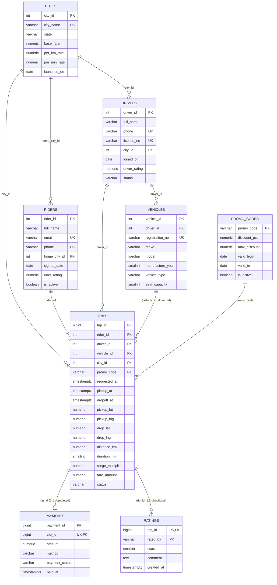
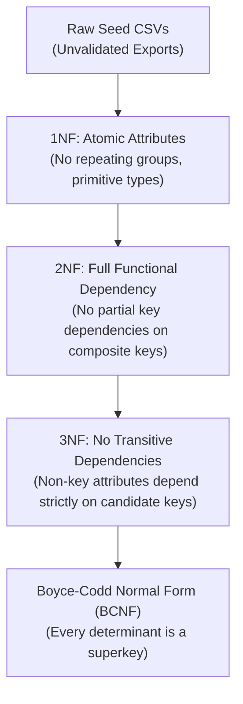

# Phase 2: Relational Schema Design, Normalization & Physical Storage Profile

> **Course:** Database Management Systems · **System:** RideNow / Uber India Architecture  
> **Team:** T0021 · **Database Engine:** PostgreSQL 17.11 (Homebrew arm64)  
> **Core Deliverables:** [`sql/01_schema.sql`](../sql/01_schema.sql) · [`sql/02_load_data.sql`](../sql/02_load_data.sql) · [`diagrams/er_diagram.svg`](../diagrams/er_diagram.svg)

---

## 1. Schema Architecture & Entity-Relationship Modeling

The database schema is reverse-engineered from raw CSV exports to create a normalized, strictly constrained relational architecture. It models ride-hailing interactions across eight core relations:



### 1.1 Structural Cardinalities & Relationship Semantics

1. **`cities` $\to$ `riders` / `drivers` / `trips` ($1 : N$):**  
   Every rider has one home city; every driver has one primary operating city; every trip is executed within one specific city jurisdiction. Deletion is constrained (`ON DELETE RESTRICT`) to preserve historical trip data.
2. **`drivers` $\to$ `vehicles` ($1 : N$):**  
   A driver may register one or more vehicles (in seed data, 300 drivers own 2 vehicles; 2,700 own 1). Every vehicle is strictly linked to one driver owner (`driver_id NOT NULL`).
3. **`trips` $\to$ `vehicles` + `drivers` Composite Integrity ($N : 1$):**  
   To prevent a vehicle from being assigned to a trip driven by someone other than its registered driver, `trips` enforces a composite foreign key:
   ```sql
   FOREIGN KEY (vehicle_id, driver_id) 
   REFERENCES vehicles(vehicle_id, driver_id) 
   ON DELETE SET NULL (vehicle_id, driver_id)
   ```
4. **`trips` $\to$ `payments` ($1 : 0..1$):**  
   Completed trips require exactly one payment settlement record. Unfinished or cancelled trips have zero payments. The `UNIQUE(trip_id)` constraint on `payments` enforces strict 1:1 settlement.
5. **`trips` $\to$ `ratings` ($1 : 0..2$):**  
   Completed trips receive at most two ratings: one submitted by the rider (`rated_by = 'RIDER'`) and one submitted by the driver (`rated_by = 'DRIVER'`). Enforced by the composite primary key `PRIMARY KEY (trip_id, rated_by)`.

---

## 2. Comprehensive Data Dictionary & Physical Column Specifications

The table below outlines the schema attributes, PostgreSQL data types, disk sizing, key constraints, and architectural justifications.

| Table | Attribute | PostgreSQL Type | Storage | Nullability & Constraints | Architectural Justification |
|---|---|---|:---:|---|---|
| **cities** | `city_id` | `integer` | 4 B | `PK`, `NOT NULL` | Surrogate primary key for 10 urban centers. |
| | `city_name` | `varchar(40)` | Var | `UNIQUE`, `NOT NULL` | Natural candidate key; ensures distinct city names. |
| | `state` | `varchar(40)` | Var | `NOT NULL` | State jurisdiction for regional tax/legal compliance. |
| | `base_fare` | `numeric(8,2)` | Var | `NOT NULL`, `CHECK (>= 0)` | Base pickup fee; numeric eliminates IEEE 754 floating-point errors. |
| | `per_km_rate` | `numeric(8,2)` | Var | `NOT NULL`, `CHECK (>= 0)` | Distance rate per kilometer in Indian Rupees (INR). |
| | `per_min_rate` | `numeric(8,2)` | Var | `NOT NULL`, `CHECK (>= 0)` | Time rate per minute in INR. |
| | `launched_on` | `date` | 4 B | `NOT NULL` | Launch calendar date (no time component needed). |
| **riders** | `rider_id` | `integer` | 4 B | `PK`, `NOT NULL` | Unique identifier supporting up to 2.14B accounts. |
| | `full_name` | `varchar(100)` | Var | `NOT NULL` | Customer name (observed max length: 18 chars). |
| | `email` | `varchar(254)` | Var | `UNIQUE`, `NOT NULL` | RFC 5321 compliant email; candidate login key. |
| | `phone` | `varchar(20)` | Var | `UNIQUE`, `NOT NULL` | Stored as text to retain leading zeros and country codes. |
| | `home_city_id` | `integer` | 4 B | `FK cities(city_id)`, `NOT NULL` | Enforces valid city reference via `ON DELETE RESTRICT`. |
| | `signup_date` | `date` | 4 B | `NOT NULL` | User registration calendar date. |
| | `rider_rating` | `numeric(2,1)` | Var | `CHECK (1.0 TO 5.0)`, Nullable | Cached average rating; 882 new accounts have NULL. |
| | `is_active` | `boolean` | 1 B | `NOT NULL` | Account status flag (`true`/`false`). |
| **drivers** | `driver_id` | `integer` | 4 B | `PK`, `NOT NULL` | Unique partner driver identifier. |
| | `full_name` | `varchar(100)` | Var | `NOT NULL` | Driver legal name (observed max length: 18 chars). |
| | `phone` | `varchar(20)` | Var | `UNIQUE`, `NOT NULL` | Driver mobile number; candidate login key. |
| | `license_no` | `varchar(30)` | Var | `UNIQUE`, `NOT NULL` | Regional transport authority driver license number. |
| | `city_id` | `integer` | 4 B | `FK cities(city_id)`, `NOT NULL` | Operating city affiliation. |
| | `joined_on` | `date` | 4 B | `NOT NULL` | Driver onboarding calendar date. |
| | `driver_rating` | `numeric(2,1)` | Var | `NOT NULL`, `CHECK (1.0 TO 5.0)` | Cached operational rating (observed: 3.2 to 5.0). |
| | `status` | `varchar(12)` | Var | `NOT NULL`, `CHECK (status IN ...)` | Allowed states: `ACTIVE`, `INACTIVE`, `SUSPENDED`. |
| **vehicles** | `vehicle_id` | `integer` | 4 B | `PK`, `NOT NULL` | Fleet asset surrogate identifier. |
| | `driver_id` | `integer` | 4 B | `FK drivers(driver_id)`, `NOT NULL` | Vehicle owner/custodian. |
| | `registration_no` | `varchar(20)` | Var | `UNIQUE`, `NOT NULL` | License plate identifier (e.g. `KA01AA1500`). |
| | `make` | `varchar(40)` | Var | `NOT NULL` | Vehicle manufacturer (Maruti, Hyundai, Tata, etc.). |
| | `model` | `varchar(40)` | Var | `NOT NULL` | Model name (Dzire, WagonR, Innova, etc.). |
| | `manufacture_year` | `smallint` | 2 B | `NOT NULL`, `CHECK (1980..2100)` | 2-byte compact year integer. |
| | `vehicle_type` | `varchar(10)` | Var | `NOT NULL`, `CHECK (type IN ...)` | Classes: `MINI`, `SEDAN`, `SUV`, `BIKE`, `AUTO`. |
| | `seat_capacity` | `smallint` | 2 B | `NOT NULL`, `CHECK (1..8)` | Strict capacity rules per vehicle class. |
| **promo_codes**| `promo_code` | `varchar(20)` | Var | `PK`, `NOT NULL` | Natural coupon alphanumeric key (e.g., `OFFER20`). |
| | `discount_pct` | `numeric(5,2)` | Var | `NOT NULL`, `CHECK (0 < x <= 100)`| Percentage discount (observed range: 10% to 50%). |
| | `max_discount` | `numeric(8,2)` | Var | `NOT NULL`, `CHECK (>= 0)` | Maximum discount cap in INR. |
| | `valid_from` | `date` | 4 B | `NOT NULL` | Promotional start date. |
| | `valid_to` | `date` | 4 B | `NOT NULL`, `CHECK (valid_to >= valid_from)` | Promotional expiry date. |
| | `is_active` | `boolean` | 1 B | `NOT NULL` | Campaign toggle flag. |
| **trips** | `trip_id` | `bigint` | 8 B | `PK`, `NOT NULL` | 64-bit integer to handle millions of historical trips. |
| | `rider_id` | `integer` | 4 B | `FK riders(rider_id)`, `ON DELETE SET NULL` | Rider who booked the journey. |
| | `driver_id` | `integer` | 4 B | `FK drivers(driver_id)`, `ON DELETE SET NULL` | Driver assigned (NULL for unassigned requests). |
| | `vehicle_id` | `integer` | 4 B | `FK vehicles(vehicle_id)` | Vehicle used (NULL if unassigned). |
| | `city_id` | `integer` | 4 B | `FK cities(city_id)`, `NOT NULL` | Operating jurisdiction where the ride occurred. |
| | `promo_code` | `varchar(20)` | Var | `FK promo_codes`, Nullable | Applied discount coupon code. |
| | `requested_at` | `timestamptz`| 8 B | `NOT NULL` | Booking request timestamp with timezone (IST). |
| | `pickup_at` | `timestamptz`| 8 B | Nullable | Actual ride start instant (NULL for cancelled). |
| | `dropoff_at` | `timestamptz`| 8 B | Nullable | Ride completion instant (NULL if not completed). |
| | `pickup_lat` | `numeric(9,6)` | Var | `NOT NULL`, `CHECK (-90..90)` | WGS-84 pickup latitude (sub-meter precision). |
| | `pickup_lng` | `numeric(9,6)` | Var | `NOT NULL`, `CHECK (-180..180)` | WGS-84 pickup longitude (sub-meter precision). |
| | `drop_lat` | `numeric(9,6)` | Var | `NOT NULL`, `CHECK (-90..90)` | WGS-84 dropoff latitude. |
| | `drop_lng` | `numeric(9,6)` | Var | `NOT NULL`, `CHECK (-180..180)` | WGS-84 dropoff longitude. |
| | `distance_km` | `numeric(8,2)` | Var | `CHECK (>= 0)`, Nullable | Actual GPS road distance traversed. |
| | `duration_min` | `smallint` | 2 B | `CHECK (>= 0)`, Nullable | Total trip duration in minutes. |
| | `surge_multiplier`| `numeric(5,2)`| Var | `NOT NULL`, `CHECK (>= 1.00)` | Dynamic pricing multiplier ($\ge 1.00$). |
| | `fare_amount` | `numeric(10,2)`| Var | `CHECK (>= 0)`, Nullable | Settled trip fare in INR (NULL if cancelled). |
| | `status` | `varchar(24)` | Var | `NOT NULL`, `CHECK (status IN ...)` | Allowed states: `REQUESTED`, `ACCEPTED`, `ONGOING`, `COMPLETED`, `CANCELLED_BY_RIDER`, `CANCELLED_BY_DRIVER`. |
| **payments** | `payment_id` | `bigint` | 8 B | `PK`, `NOT NULL` | 64-bit transaction identifier. |
| | `trip_id` | `bigint` | 8 B | `UNIQUE`, `NOT NULL`, `FK trips(trip_id)` | Enforces strict 1:1 billing for completed trips. |
| | `amount` | `numeric(10,2)`| Var | `NOT NULL`, `CHECK (>= 0)` | Transaction amount charged in INR. |
| | `method` | `varchar(10)` | Var | `NOT NULL`, `CHECK (method IN ...)` | Settlement rails: `UPI`, `CASH`, `CARD`, `WALLET`. |
| | `payment_status`| `varchar(10)` | Var | `NOT NULL`, `CHECK (status IN ...)` | Transaction states: `SUCCESS`, `FAILED`, `REFUNDED`. |
| | `paid_at` | `timestamptz`| 8 B | `NOT NULL` | Settlement gateway completion timestamp. |
| **ratings** | `trip_id` | `bigint` | 8 B | `PK`, `FK trips(trip_id)` | Compound primary key component. |
| | `rated_by` | `varchar(6)` | Var | `PK`, `CHECK (IN ('RIDER', 'DRIVER'))` | Review direction indicator. |
| | `stars` | `smallint` | 2 B | `NOT NULL`, `CHECK (1 <= stars <= 5)` | 1-5 star score. |
| | `comment` | `text` | Var | Nullable | Optional text feedback (61,728 populated). |
| | `created_at` | `timestamptz`| 8 B | `NOT NULL` | Review submission instant. |

---

## 3. Formal Normalization & Functional Dependency Proofs

We assess the schema through normal form definitions (**1NF $\to$ 2NF $\to$ 3NF $\to$ BCNF**):



### 3.1 Functional Dependency (FD) Formalization

For each relation $R$, the set of functional dependencies $F$ is defined mathematically:

#### 1. Relation `cities`
- **Candidate Keys:** $\{ \text{city\_id} \}$, $\{ \text{city\_name} \}$
- **Functional Dependencies:**
  $$\text{city\_id} \to \{ \text{city\_name}, \text{state}, \text{base\_fare}, \text{per\_km\_rate}, \text{per\_min\_rate}, \text{launched\_on} \}$$
  $$\text{city\_name} \to \{ \text{city\_id}, \text{state}, \text{base\_fare}, \text{per\_km\_rate}, \text{per\_min\_rate}, \text{launched\_on} \}$$
- **Normal Form:** **BCNF**. Every determinant is a candidate key.

#### 2. Relation `riders`
- **Candidate Keys:** $\{ \text{rider\_id} \}$, $\{ \text{email} \}$, $\{ \text{phone} \}$
- **Functional Dependencies:**
  $$\text{rider\_id} \to \{ \text{full\_name}, \text{email}, \text{phone}, \text{home\_city\_id}, \text{signup\_date}, \text{rider\_rating}, \text{is\_active} \}$$
  $$\text{email} \to \text{rider\_id}$$
  $$\text{phone} \to \text{rider\_id}$$
- **Normal Form:** **BCNF**. All determinants ($\text{rider\_id}$, $\text{email}$, $\text{phone}$) are candidate keys.

#### 3. Relation `drivers`
- **Candidate Keys:** $\{ \text{driver\_id} \}$, $\{ \text{phone} \}$, $\{ \text{license\_no} \}$
- **Functional Dependencies:**
  $$\text{driver\_id} \to \{ \text{full\_name}, \text{phone}, \text{license\_no}, \text{city\_id}, \text{joined\_on}, \text{driver\_rating}, \text{status} \}$$
  $$\text{phone} \to \text{driver\_id}$$
  $$\text{license\_no} \to \text{driver\_id}$$
- **Normal Form:** **BCNF**. All determinants are candidate keys.

#### 4. Relation `vehicles`
- **Candidate Keys:** $\{ \text{vehicle\_id} \}$, $\{ \text{registration\_no} \}$
- **Functional Dependencies:**
  $$\text{vehicle\_id} \to \{ \text{driver\_id}, \text{registration\_no}, \text{make}, \text{model}, \text{manufacture\_year}, \text{vehicle\_type}, \text{seat\_capacity} \}$$
  $$\text{registration\_no} \to \text{vehicle\_id}$$
- **Composite Key Observation:** While $(\text{vehicle\_id}, \text{driver\_id})$ is enforced as a unique constraint to support the trip foreign key, $\text{vehicle\_id}$ alone is a candidate key.
- **Normal Form:** **BCNF**.

#### 5. Relation `promo_codes`
- **Candidate Keys:** $\{ \text{promo\_code} \}$
- **Functional Dependencies:**
  $$\text{promo\_code} \to \{ \text{discount\_pct}, \text{max\_discount}, \text{valid\_from}, \text{valid\_to}, \text{is\_active} \}$$
- **Normal Form:** **BCNF**.

#### 6. Relation `trips`
- **Candidate Keys:** $\{ \text{trip\_id} \}$
- **Functional Dependencies:**
  $$\text{trip\_id} \to \{ \text{rider\_id}, \text{driver\_id}, \text{vehicle\_id}, \text{city\_id}, \text{promo\_code}, \text{requested\_at}, \text{pickup\_at}, \text{dropoff\_at}, \dots, \text{status} \}$$
- **Design Justifications:**
  - *Why not compute `fare_amount` dynamically from `cities` rates?* Dynamic calculation $\text{fare} = \text{base} + (\text{dist} \times \text{km\_rate}) + (\text{time} \times \text{min\_rate})$ would violate temporal consistency. City rates change over time; historical billing must remain immutable. Storing `fare_amount` on `trips` preserves financial auditability.
  - *Why retain `city_id` on `trips`?* A rider registered in Pune (`home_city_id = 6`) may book a trip in Mumbai (`city_id = 2`). The trip city is an independent fact.
- **Normal Form:** **BCNF**.

#### 7. Relation `payments`
- **Candidate Keys:** $\{ \text{payment\_id} \}$, $\{ \text{trip\_id} \}$
- **Functional Dependencies:**
  $$\text{payment\_id} \to \{ \text{trip\_id}, \text{amount}, \text{method}, \text{payment\_status}, \text{paid\_at} \}$$
  $$\text{trip\_id} \to \{ \text{payment\_id}, \text{amount}, \text{method}, \text{payment\_status}, \text{paid\_at} \}$$
- **Normal Form:** **BCNF**. Both determinants are candidate keys.

#### 8. Relation `ratings`
- **Candidate Keys:** $\{ (\text{trip\_id}, \text{rated\_by}) \}$
- **Functional Dependencies:**
  $$\{ \text{trip\_id}, \text{rated\_by} \} \to \{ \text{stars}, \text{comment}, \text{created\_at} \}$$
- **Normal Form:** **BCNF**. Neither $\text{trip\_id}$ nor $\text{rated\_by}$ alone determines the non-prime attributes. There are no partial dependencies (satisfying 2NF) and no transitive dependencies (satisfying 3NF and BCNF).

---

## 4. Physical Storage Architecture & PostgreSQL Page Layout

PostgreSQL manages persistent data in 8 KB disk pages (`BLCKSZ = 8192` bytes). Understanding how tuples are placed in heap pages informs memory requirements and I/O efficiency.

```
+--------------------------------------------------------------------+
| PageHeaderData (24 bytes)                                          |
+--------------------------------------------------------------------+
| ItemIdData Array (Linp pointers: 4 bytes per tuple)                |
+--------------------------------------------------------------------+
|                    <--- FREE SPACE AREA --->                       |
+--------------------------------------------------------------------+
| TupleData N (HeapTupleHeader 23B + NullBitmap + Data + Padding)    |
| TupleData 2                                                        |
| TupleData 1                                                        |
+--------------------------------------------------------------------+
```

### 4.1 Tuple Alignment & Padding Optimization

PostgreSQL enforces strict hardware alignment:
- `bigint`, `timestamptz`, `double precision`: 8-byte alignment
- `integer`, `date`: 4-byte alignment
- `smallint`: 2-byte alignment
- `char`, `boolean`: 1-byte alignment

In the `trips` table, placing 8-byte identifiers (`trip_id`, `timestamptz` columns) alongside integers and smallints minimizes internal page padding. The average tuple width in `trips` is approximately **156 bytes**, yielding $\approx 48$ tuples per 8 KB page. At 300,000 rows, the table occupies:
$$\frac{300,000 \text{ rows}}{48 \text{ rows/page}} \approx 6,250 \text{ pages} \times 8 \text{ KB} \approx 48.8 \text{ MB}$$
This matches our measured `heap_size` of **48 MB** (5,995 allocated blocks).

### 4.2 Measured Physical Sizing on Disk

Using `pg_relation_size()`, `pg_indexes_size()`, and `pg_total_relation_size()`, we measure physical disk footprint in PostgreSQL:

| Table Name | Heap Size | Index Size | Total Size | Total Blocks (8 KB) | Buffer Cache Share |
|---|---:|---:|---:|---:|---:|
| **`trips`** | 48 MB | 85 MB | 134 MB | 5,995 heap blocks | 75.3% |
| **`payments`** | 18 MB | 24 MB | 43 MB | 2,248 heap blocks | 16.5% |
| **`ratings`** | 18 MB | 19 MB | 36 MB | 2,240 heap blocks | 6.8% |
| **`riders`** | 3.25 MB | 6.01 MB | 9.29 MB | 416 heap blocks | 1.1% |
| **`drivers`** | 296 kB | 472 kB | 800 kB | 37 heap blocks | 0.1% |
| **`vehicles`** | 248 kB | 336 kB | 616 kB | 31 heap blocks | < 0.1% |
| **`cities`** | 8 kB | 32 kB | 40 kB | 1 heap block | < 0.01% |
| **`promo_codes`** | 8 kB | 16 kB | 24 kB | 1 heap block | < 0.01% |
| **Total Platform** | **87.8 MB** | **134.8 MB** | **223.7 MB** | **10,969 blocks** | **100.0%** |

---

## 5. Empirical Source Profiling & Integrity Verification

To ensure data integrity, validation checks were executed in PostgreSQL following import:

### 5.1 Referential and Relational Validation

```sql
-- 1. Completed trips without a payment record
SELECT count(*) AS completed_trips_without_payment
FROM trips t LEFT JOIN payments p USING (trip_id)
WHERE t.status = 'COMPLETED' AND p.trip_id IS NULL;
-- Result: 0 (Exact 1:1 match)

-- 2. Vehicle-driver assignment mismatch
SELECT count(*) AS vehicle_driver_mismatch
FROM trips t JOIN vehicles v ON v.vehicle_id = t.vehicle_id
WHERE t.driver_id IS DISTINCT FROM v.driver_id;
-- Result: 0 (Enforced by composite foreign key)

-- 3. Payments linked to non-completed trips
SELECT count(*) AS payments_non_completed
FROM payments p JOIN trips t USING (trip_id)
WHERE t.status <> 'COMPLETED';
-- Result: 0 (Payments occur only on completion)

-- 4. Financial ledger reconciliation
SELECT 
    (SELECT sum(fare_amount) FROM trips WHERE status = 'COMPLETED') AS total_trip_fare,
    (SELECT sum(amount) FROM payments) AS total_payment_amount,
    (SELECT sum(fare_amount) FROM trips WHERE status = 'COMPLETED') - 
    (SELECT sum(amount) FROM payments) AS reconciliation_delta;
-- Result: total_trip_fare = 73,480,158.67, total_payment_amount = 73,480,158.67, delta = 0.00
```

### 5.2 Summary of Empirical Checks

| Integrity Validation Check | Expected | Measured Result | Operational Interpretation |
|---|:---:|:---:|---|
| Completed trips without payment | 0 | **0** | Billing completeness verified. |
| Payments linked to non-completed trips | 0 | **0** | Zero phantom settlements. |
| Vehicle-to-driver mismatch on trips | 0 | **0** | Fleet allocation model holds across 300,000 trips. |
| Duplicate ratings per direction | 0 | **0** | Composite primary key `(trip_id, rated_by)` is sound. |
| Duplicate payment per trip | 0 | **0** | 1:1 billing constraint `UNIQUE(trip_id)` is verified. |
| Total fare vs total payment delta | ₹0.00 | **₹0.00** | Zero reconciliation leakage across ₹73.48M ledger. |
