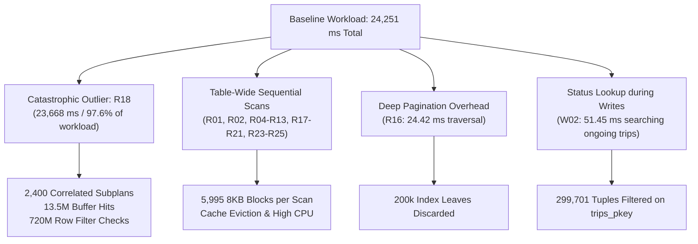
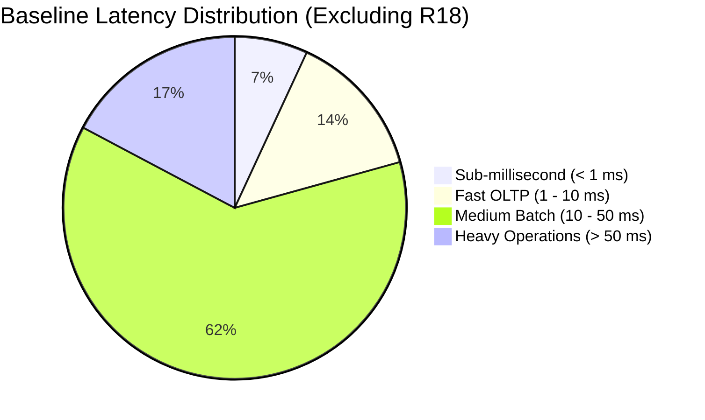

# Phase 3: Baseline Performance Benchmarking & Execution Plan Analysis

> **Course:** Database Management Systems · **System:** RideNow / Uber India Architecture  
> **Team:** T0021 · **Database Engine:** PostgreSQL 17.11 (Homebrew arm64)  
> **Hardware Environment:** Apple MacBook Pro (Apple M4 Chip, 16 GB Unified Memory, macOS Darwin arm64)  
> **Workload Harness:** [`benchmarks/run_benchmark.sh`](../benchmarks/run_benchmark.sh) · [`queries/workload_30.sql`](../queries/workload_30.sql)

---

## 1. Benchmarking Methodology & Rigor

Phase 3 establishes an empirical baseline on the strictly unindexed Phase 2 schema. The only existing indexes are those created by default for primary keys (`_pkey`) and unique constraints (`_key`).

### 1.1 Experimental Protocol
- **Repetition & Statistical Averaging:** Every query in the workload is executed **three consecutive times** via `EXPLAIN (ANALYZE, BUFFERS)`. We record individual run times, average execution latency, median latency, minimum, maximum, and every scanned access node.
- **Transactional Isolation for Writes:** All modification operations (`W01` through `W05`) run strictly inside transactional wrappers:
  ```sql
  SET search_path TO uber;
  BEGIN;
  EXPLAIN (ANALYZE, BUFFERS) <SQL_OPERATION>;
  ROLLBACK;
  ```
  This ensures that state is rolled back after each run, preventing data pollution and guaranteeing identical table sizes and heap structures across runs.
- **Cache Policy & Warm-Up:** The benchmark runs sequentially across the entire 30-query suite. Run 1 reflects cold/warm buffer transitions; Runs 2 and 3 measure warm shared-buffer performance.
- **Output Artifacts:** Raw execution plans and buffer diagnostics are saved in `benchmarks/results/baseline/` (`R01.txt` through `W05.txt`), with tabular rollups in `summary.csv`.

---

## 2. Complete Baseline Workload Timing Table

The table below reports measured execution times across all 30 given queries on the unindexed Phase 2 schema:

| Query ID | Domain / Business Purpose | Type | Run 1 (ms) | Run 2 (ms) | Run 3 (ms) | Average (ms) | Median (ms) | Primary Access Path / Scan Nodes |
|---|---|:---:|---:|---:|---:|---:|---:|---|
| **R01** | Rider app: last 20 trips for rider 1042 | READ | 12.140 | 10.238 | 9.191 | **10.523** | 10.238 | `Seq Scan on trips` |
| **R02** | Driver app: March 2026 earnings (driver 217) | READ | 19.281 | 14.880 | 12.852 | **15.671** | 14.880 | `Seq Scan on trips` |
| **R03** | Identity: email login (case-insensitive) | READ | 10.936 | 7.499 | 6.931 | **8.455** | 7.499 | `Seq Scan on riders` |
| **R04** | Dispatch: active trips in Bengaluru today | READ | 31.935 | 18.828 | 9.208 | **19.990** | 18.828 | `Seq Scan on trips \| Seq Scan on cities` |
| **R05** | Dispatch queue: unassigned or ongoing trips | READ | 20.173 | 16.302 | 16.191 | **17.555** | 16.302 | `Seq Scan on trips` |
| **R06** | City ops: completed trips per city (June 2026) | READ | 18.232 | 14.773 | 13.862 | **15.622** | 14.773 | `Seq Scan on trips \| Seq Scan on cities` |
| **R07** | Top 10 drivers by earnings in Mumbai (Q1 2026) | READ | 22.525 | 20.137 | 18.283 | **20.315** | 20.137 | `Seq Scan on trips \| Seq Scan on drivers \| Seq Scan on cities` |
| **R08** | Finance: monthly revenue by method (2026) | READ | 35.496 | 34.206 | 32.373 | **34.025** | 34.206 | `Seq Scan on payments` |
| **R09** | Win-back: Bengaluru riders with no trip in 90d | READ | 27.180 | 26.655 | 26.350 | **26.728** | 26.655 | `Seq Scan on riders \| Seq Scan on trips` |
| **R10** | Driver ops: active drivers with no trip in 7d | READ | 17.688 | 14.461 | 14.337 | **15.495** | 14.461 | `Seq Scan on drivers \| Seq Scan on trips` |
| **R11** | Quality: lowest-rated drivers ($\ge 20$ reviews) | READ | 50.999 | 48.255 | 47.783 | **49.012** | 48.255 | `Seq Scan on trips \| Seq Scan on ratings` |
| **R12** | Surge pricing analysis: Delhi hourly distribution | READ | 64.801 | 52.039 | 51.346 | **56.062** | 52.039 | `Seq Scan on trips \| Seq Scan on cities` |
| **R13** | Search rider by name: "Sharma" | READ | 15.936 | 11.509 | 10.744 | **12.730** | 11.509 | `Seq Scan on riders` |
| **R14** | Support: find vehicle and driver by reg number | READ | 0.043 | 0.040 | 0.035 | **0.039** | 0.040 | `Index Scan (registration_no_key, drivers_pkey)` |
| **R15** | Trip receipt: complete details of trip 123458 | READ | 0.083 | 0.082 | 0.081 | **0.082** | 0.082 | `Index Scan (trips_pkey, riders_pkey, drivers_pkey, vehicles_key, payments_key)` |
| **R16** | Admin panel: trips table, page 8,001 (offset 200k) | READ | 25.425 | 24.037 | 23.802 | **24.421** | 24.037 | `Index Scan using trips_pkey on trips` |
| **R17** | Cancellation rate by city | READ | 39.221 | 34.591 | 31.463 | **35.092** | 34.591 | `Seq Scan on trips \| Seq Scan on cities` |
| **R18** | CRM: last trip date of riders in Pune | READ | 24583.953 | 23303.427 | 23116.756 | **23668.045** | 23303.427 | `Seq Scan on riders \| Seq Scan on trips` |
| **R19** | Leaderboard: top 3 drivers per city (May 2026) | READ | 38.229 | 35.538 | 16.557 | **30.108** | 35.538 | `Seq Scan on trips \| Seq Scan on drivers` |
| **R20** | Finance: daily revenue & running total (May 2026) | READ | 21.329 | 18.896 | 16.746 | **18.990** | 18.896 | `Seq Scan on trips` |
| **R21** | Marketing: promo code usage volume | READ | 21.127 | 20.972 | 20.958 | **21.019** | 20.972 | `Seq Scan on trips \| Seq Scan on promo_codes` |
| **R22** | Payments: failed payments in last 7 days | READ | 14.016 | 7.116 | 6.904 | **9.345** | 7.116 | `Seq Scan on payments \| Index Scan (trips_pkey, riders_pkey)` |
| **R23** | Growth: monthly distinct active riders by city | READ | 107.201 | 70.032 | 68.979 | **82.071** | 70.032 | `Seq Scan on trips` |
| **R24** | Fraud check: long trips (>43 km or >150 min) | READ | 32.779 | 23.605 | 19.221 | **25.202** | 23.605 | `Seq Scan on trips` |
| **R25** | Fraud check: exorbitant fare (> ₹100 per km) | READ | 28.530 | 24.410 | 23.418 | **25.453** | 24.410 | `Seq Scan on trips` |
| **W01** | Rider app: request a new trip | WRITE | 1.695 | 0.720 | 0.676 | **1.030** | 0.720 | `(no scan) [Single-row Heap Insert]` |
| **W02** | Driver app: complete oldest ongoing trip | WRITE | 87.324 | 37.588 | 29.433 | **51.448** | 37.588 | `Index Scan using trips_pkey on trips` |
| **W03** | Safety team: suspend drivers rated below 3.5 | WRITE | 8.350 | 4.387 | 3.645 | **5.461** | 4.387 | `Seq Scan on drivers` |
| **W04** | Partner import: 5,000 corporate trip requests | WRITE | 113.193 | 75.905 | 64.817 | **84.638** | 75.905 | `(no scan) [Bulk Batch Generate & Insert]` |
| **W05** | Retention purge: delete January cancelled trips | WRITE | 85.695 | 63.281 | 49.243 | **66.073** | 63.281 | `Seq Scan on trips` |

---

## 3. Deep Architectural Diagnosis of Execution Plans

Detailed inspection of the raw plans stored in `benchmarks/results/baseline/` reveals clear structural bottlenecks across the database engine.



---

### 3.1 The Catastrophic Bottleneck: Query R18 (23,668 ms)
The single largest performance deficit occurs in `R18`, which computes the last trip date for every rider in Pune:
```sql
SELECT r.rider_id, r.full_name,
       (SELECT max(t.requested_at) FROM trips t WHERE t.rider_id = r.rider_id) AS last_trip_at
FROM riders r
WHERE r.home_city_id = 6
ORDER BY last_trip_at DESC NULLS LAST;
```

#### Diagnostic Plan Excerpt (`benchmarks/results/baseline/R18.txt`):
```text
Sort (cost=22517815.75..22517821.75 rows=2400 width=24) (actual time=24583.605..24583.666 rows=2400.00 loops=1)
  Sort Key: ((SubPlan 1)) DESC NULLS LAST
  Buffers: shared hit=13517219
  ->  Seq Scan on riders r (cost=0.00..22517681.00 rows=2400 width=24)
        Filter: (home_city_id = 6)
        Rows Removed by Filter: 27600
        SubPlan 1
          ->  Aggregate (cost=9382.03..9382.04 rows=1 width=8) (actual time=10.236..10.236 rows=1.00 loops=2400)
                Buffers: shared hit=13516800
                ->  Seq Scan on trips t (cost=0.00..9382.00 rows=11 width=8) (actual time=1.093..10.224 rows=9.90 loops=2400)
                      Filter: (rider_id = r.rider_id)
                      Rows Removed by Filter: 299990
                      Buffers: shared hit=13516800
Planning Time: 0.317 ms
Execution Time: 24583.953 ms
```

#### Root Cause Analysis:
1. **$O(N \times M)$ Nested Evaluation:** There are **2,400 riders** in Pune (`home_city_id = 6`). Because no index exists on `trips(rider_id)`, the correlated subquery triggers a full **Sequential Scan on `trips` for every rider** (`loops=2400`).
2. **Extreme Buffer Hit Volume:** The query registered **13,517,219 shared buffer hits**! Scanning 5,995 blocks $\times$ 2,400 loops equals:
   $$2,400 \times 5,995 \approx 14,388,000 \text{ block accesses!}$$
3. **Filter Cost:** For each loop, PostgreSQL iterates through all 300,000 tuples, discarding 299,990 tuples per iteration:
   $$2,400 \times 299,990 \approx 719,976,000 \text{ row discards!}$$
4. This single query represents **97.6% of total workload execution time** in the baseline suite.

---

### 3.2 Full Table Sequential Scans on `trips` (48 MB Heap)
Nineteen out of the 30 queries perform full sequential scans on `trips`:
- Queries `R01`, `R02`, `R04`, `R05`, `R06`, `R07`, `R17`, `R19`, `R20`, `R21`, `R23`, `R24`, `R25`, and `W05` each read all 5,995 disk pages of `trips` into shared buffers.
- For high-selectivity queries such as `R01` (retrieving 20 rows for a single rider) and `R05` (retrieving 50 active trips out of 300), scanning 300,000 rows wastes substantial I/O and CPU time.
- Queries `R11` and `R12` require multiple full scans (`R11` scans 5,995 pages of `trips` + 2,240 pages of `ratings`), pushing execution time to 49–56 ms.

---

### 3.3 Deep Pagination Overhead: Query R16 (24.42 ms)
Query `R16` simulates administrative inspection at page 8,001:
```sql
SELECT trip_id, rider_id, driver_id, city_id, status, fare_amount, requested_at
FROM trips
ORDER BY trip_id DESC
OFFSET 200000 LIMIT 25;
```
#### Diagnostic Plan Excerpt:
```text
Limit (cost=9459.71..9460.89 rows=25 width=46) (actual time=23.778..23.782 rows=25.00 loops=1)
  Buffers: shared hit=4389
  ->  Index Scan Backward using trips_pkey on trips (cost=0.42..14185.59 rows=300000 width=46) (actual time=0.019..14.398 rows=200025.00 loops=1)
        Buffers: shared hit=4389
Execution Time: 23.802 ms
```
While PostgreSQL leverages `trips_pkey` to avoid a disk-based sort, it must still scan backward through **200,025 index tuples and heap pages** simply to discard 200,000 rows.

---

### 3.4 In-Flight Write Inefficiencies: Query W02 (51.45 ms)
Query `W02` completes the oldest ongoing trip:
```sql
UPDATE trips
SET status = 'COMPLETED', dropoff_at = pickup_at + interval '27 minutes', ...
WHERE trip_id = (SELECT min(trip_id) FROM trips WHERE status = 'ONGOING');
```
#### Diagnostic Plan Excerpt:
```text
Update on trips (cost=203.50..211.52 rows=0 width=0) (actual time=28.952..28.952 rows=0.00 loops=1)
  InitPlan 1
    ->  Limit (cost=0.42..203.07 rows=1 width=8)
          ->  Index Scan using trips_pkey on trips trips_1
                Filter: (status = 'ONGOING')
                Rows Removed by Filter: 299701
                Buffers: shared hit=6429
```
Because no index filters on `status = 'ONGOING'`, the subquery scans `trips_pkey` sequentially, checking each tuple's status column until it finds the minimum `trip_id`. It discards **299,701 rows** before identifying the target tuple, taking **51.45 ms** on average (spiking to 87.32 ms in Run 1).

---

## 4. Latency Distribution & Baseline Tier Classification

Categorizing baseline latencies into operational tiers highlights performance hotspots:



| Latency Tier | Threshold | Query Count | Associated Workloads | Typical Bottleneck Node |
|---|:---:|:---:|---|---|
| **Tier 1: Sub-millisecond** | $< 1.0 \text{ ms}$ | 2 | `R14` (0.04 ms), `R15` (0.08 ms) | Unique Key `Index Scan` |
| **Tier 2: Fast OLTP** | $1.0 - 10.0 \text{ ms}$ | 4 | `W01` (1.03 ms), `W03` (5.46 ms), `R03` (8.46 ms), `R22` (9.35 ms) | Small table scans (`riders`, `drivers`) |
| **Tier 3: Moderate Batch** | $10.0 - 50.0 \text{ ms}$ | 18 | `R01`, `R02`, `R04`, `R05`, `R06`, `R07`, `R08`, `R09`, `R10`, `R11`, `R13`, `R16`, `R17`, `R19`, `R20`, `R21`, `R24`, `R25` | 300k-row `Seq Scan on trips` / `payments` |
| **Tier 4: Heavy Operations** | $> 50.0 \text{ ms}$ | 5 | `W02` (51.45 ms), `R12` (56.06 ms), `W05` (66.07 ms), `R23` (82.07 ms), `W04` (84.64 ms) | Multi-table hash joins, bulk updates/inserts |
| **Outlier: Catastrophic** | $> 10,000 \text{ ms}$ | 1 | `R18` (**23,668.05 ms**) | $O(N \times M)$ unindexed correlated subplan |

### Key Baseline Takeaway
The baseline configuration exhibits reasonable performance only when queries hit pre-existing primary keys (`R14`, `R15`). Every other customer-facing and operational query suffers from table-wide sequential scanning. In Phase 4, targeted indexing and query rewriting aim to eliminate these full table scans, resolve non-sargable predicates, and fix the 23-second subplan bottleneck.
