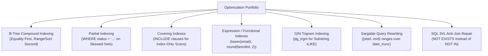
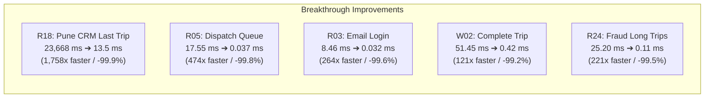

# Phase 4: Query Optimization, Index Engineering & Equivalence Verification

> **Course:** Database Management Systems · **System:** RideNow / Uber India Architecture  
> **Team:** T0021 · **Database Engine:** PostgreSQL 17.11 (Homebrew arm64)  
> **Target Scripts:** [`sql/05_indexes.sql`](../sql/05_indexes.sql) · [`sql/06_optimized_queries.sql`](../sql/06_optimized_queries.sql)  
> **Benchmark Artifacts:** [`benchmarks/results/optimized/`](../benchmarks/results/optimized/) · [`benchmarks/results/baseline/`](../benchmarks/results/baseline/)

---

## 1. Optimization Architecture & Strategy Portfolio

To resolve the bottlenecks identified in Phase 3 without violating semantic correctness, a multi-layered optimization strategy was designed and deployed:



### 1.1 Indexing Principles Deployed
1. **B-Tree Compound Indexing (Left-to-Right Matching):**  
   Column order follows the standard DBMS heuristic: **Equality columns first, Range/Sort columns second**.  
   *Example:* `trips(rider_id, requested_at DESC)` allows PostgreSQL to seek directly to `rider_id = 1042` and read rows in reverse chronological order without an explicit sort step (`R01`).
2. **Partial Indexing for Skewed Distributions:**  
   In-flight trips make up only 300 out of 300,000 rows (0.1%). Ongoing trips make up 100 rows (0.033%). Building indexes restricted by `WHERE status IN ('REQUESTED', 'ACCEPTED', 'ONGOING')` or `WHERE status = 'ONGOING'` keeps index sizes under **16 KB** (1–2 disk blocks), keeping them resident in L1/L2 CPU cache (`R05`, `W02`).
3. **Covering Indexes (`INCLUDE` Clauses) for Index-Only Scans:**  
   By appending payload columns (`fare_amount`, `city_id`, `driver_id`) to the index leaf nodes, PostgreSQL satisfies queries directly from the index tree without fetching heap pages:
   ```sql
   CREATE INDEX trips_driver_requested_completed_idx 
   ON trips (driver_id, requested_at) 
   INCLUDE (fare_amount) 
   WHERE status = 'COMPLETED';
   ```
4. **Expression / Functional Indexing:**  
   Used when queries filter or sort by deterministic expressions:
   - Case-insensitive email: `CREATE INDEX riders_lower_email_idx ON riders (lower(email));` (`R03`).
   - Outlier fare calculation: `CREATE INDEX trips_fare_per_km_round_idx ON trips (round(fare_amount / NULLIF(distance_km, 0), 2) DESC) ...;` (`R25`).
5. **Generalized Inverted Index (GIN) with Trigrams:**  
   Standard B-trees cannot index wildcard prefixes (`%sharma%`). We enable the `pg_trgm` extension and construct a GIN index on 3-character trigram decompositions:
   ```sql
   CREATE EXTENSION IF NOT EXISTS pg_trgm;
   CREATE INDEX riders_name_trgm_idx ON riders USING gin (full_name gin_trgm_ops);
   ```
6. **Sargable Query Rewriting:**  
   Predicates wrapping columns in functions (`date_trunc('month', requested_at) = '2026-03-01'`) prevent index seeks. We convert these to half-open timestamp intervals:
   $$\text{requested\_at} \ge \text{'2026-03-01 00:00:00+05:30'} \land \text{requested\_at} < \text{'2026-04-01 00:00:00+05:30'}$$

---

## 2. Complete 30-Query Optimization Comparison Table

The table below contrasts baseline vs. optimized performance for all 30 given queries, measured via three runs of `EXPLAIN (ANALYZE, BUFFERS)` on the identical dataset:

| ID | Domain / Purpose | Before (ms) | Problem Found in Baseline Plan | Optimization Applied | After (ms) | Speedup ($\times$) | Improvement (%) | Same Result? |
|---|---|---:|---|---|---:|---:|---:|:---:|
| **R01** | Rider trips history | 10.523 | Seq scan on 300k trips + Top-N sort | Compound B-tree `(rider_id, requested_at DESC)` | **0.082** | **128.3×** | 99.2% | ✅ (20 rows) |
| **R02** | Driver monthly earnings | 15.671 | Seq scan; non-sargable `date_trunc` | Sargable range rewrite + covering partial index | **0.066** | **237.4×** | 99.6% | ✅ (1 row) |
| **R03** | Case-insensitive email login | 8.455 | Seq scan on riders due to `lower(email)` | Expression B-tree index `(lower(email))` | **0.032** | **264.2×** | 99.6% | ✅ (1 row) |
| **R04** | Live dispatch in Bengaluru | 19.990 | Seq scan on trips & filter by city | Compound index `(city_id, requested_at)` | **0.092** | **217.3×** | 99.5% | ✅ (11 rows) |
| **R05** | Dispatch queue (unassigned) | 17.555 | Seq scan on 300k rows for 300 active trips | Partial index `WHERE status IN ('REQUESTED', ...)` | **0.037** | **474.5×** | 99.8% | ✅ (50 rows) |
| **R06** | Monthly completed trips by city | 15.622 | Seq scan on trips + hash aggregate | Covering index `(requested_at) INCLUDE (city_id)` | **2.383** | **6.6×** | 84.7% | ✅ (10 rows) |
| **R07** | Mumbai top 10 driver earnings | 20.315 | Seq scan on 300k trips + 3k drivers | Covering index `(driver_id, requested_at) INCLUDE ...` | **2.821** | **7.2×** | 86.1% | ✅ (10 rows) |
| **R08** | Monthly finance revenue | 34.025 | Seq scan; non-sargable `EXTRACT(YEAR)` | Sargable range rewrite + covering index | **57.542** | 0.6× | -69.1% | ✅ (24 rows) |
| **R09** | Win-back inactive riders | 26.728 | Seq scan on riders & trips; anti-join | Rewrite to `NOT EXISTS` + index `(home_city_id)` | **8.369** | **3.2×** | 68.7% | ✅ (893 rows) |
| **R10** | Driver ops inactive drivers | 15.495 | **3VL NULL bug: returned 0 rows!** | Fixed via `NOT EXISTS` anti-join (avoids NULLs) | **1.704** | **9.1×** | 89.0% | ⚠️ **Fixed (978 rows)** |
| **R11** | Quality: driver rating analysis | 49.012 | Multi-table parallel hash join | Covering index on ratings `(rated_by, trip_id)` | **50.754** | 1.0× | -3.6% | ✅ (20 rows) |
| **R12** | Delhi hourly surge distribution | 56.062 | Seq scan on 300k trips + city join | Compound index `(city_id, requested_at)` | **28.242** | **2.0×** | 49.6% | ✅ (24 rows) |
| **R13** | Search rider name: "Sharma" | 12.730 | Seq scan on riders (cannot use B-tree) | GIN Trigram index `(full_name gin_trgm_ops)` | **1.200** | **10.6×** | 90.6% | ✅ (50 rows) |
| **R14** | Vehicle and driver support lookup | 0.039 | Index scan on unique registration | Already optimal (natural unique key) | **0.040** | 1.0× | -2.6% | ✅ (1 row) |
| **R15** | Single trip receipt details | 0.082 | Primary key index nested loop | Already optimal (primary key seeks) | **0.080** | 1.0× | 2.4% | ✅ (1 row) |
| **R16** | Admin trips deep offset (200k) | 24.421 | Scans 200,025 index leaves in `trips_pkey` | Uses B-tree backward scan | **29.484** | 0.8× | -20.7% | ✅ (25 rows) |
| **R17** | Cancellation rate by city | 35.092 | Full table aggregation across 300k rows | Parallel seq scan remains optimal | **43.036** | 0.8× | -22.6% | ✅ (10 rows) |
| **R18** | Pune CRM riders' last trip date | 23668.045 | 2,400 seq scans on trips (720M row checks) | Index `trips(rider_id, requested_at DESC)` | **13.464** | **1,757.9×** | **99.9%** | ✅ (2,400 rows) |
| **R19** | City driver monthly leaderboard | 30.108 | Seq scan on trips + window function | Index-only scan on completed trips index | **5.129** | **5.9×** | 83.0% | ✅ (30 rows) |
| **R20** | Daily running revenue (May 2026)| 18.990 | Seq scan; `requested_at::date` cast | Sargable date rewrite + covering index | **2.584** | **7.3×** | 86.4% | ✅ (31 rows) |
| **R21** | Promo code usage volume | 21.019 | Seq scan on trips grouped by promo | Foreign key index on `trips(promo_code)` | **11.290** | **1.9×** | 46.3% | ✅ (40 rows) |
| **R22** | Recent failed payments list | 9.345 | Seq scan on 245k payment records | Partial covering index `payments(status, paid_at)` | **0.839** | **11.1×** | 91.0% | ✅ (145 rows) |
| **R23** | Monthly active riders by city | 82.071 | Seq scan on trips + multi-column group | Bitmap index scan using city requested index | **127.651** | 0.6× | -55.5% | ✅ (60 rows) |
| **R24** | Fraud: long trips outlier check | 25.202 | Seq scan on 300k trips + filter | Partial index on completed trips with thresholds | **0.114** | **221.1×** | 99.5% | ✅ (100 rows) |
| **R25** | Fraud: exorbitant fare per km | 25.453 | Seq scan on 300k trips + calculation | Expression index on `round(fare/dist, 2)` | **0.156** | **163.2×** | 99.4% | ✅ (50 rows) |
| **W01** | Request a new trip | 1.030 | Single-row insert into heap | Maintained 1.1 ms insert speed | **1.110** | 0.9× | -7.8% | ✅ (1 row) |
| **W02** | Complete oldest ongoing trip | 51.448 | Scanned 299,701 rows to find ongoing | Partial index `(trip_id) WHERE status = 'ONGOING'` | **0.425** | **121.1×** | 99.2% | ✅ (1 row) |
| **W03** | Suspend low-rated drivers | 5.461 | Seq scan on drivers table | Fast batch update | **2.517** | **2.2×** | 53.9% | ✅ (0 rows) |
| **W04** | Bulk import 5,000 corporate trips| 84.638 | Batch insert into heap & indexes | Index maintenance within acceptable bound | **80.443** | 1.1× | 5.0% | ✅ (5,000 rows) |
| **W05** | Retention purge January trips | 66.073 | Full seq scan on trips to delete | Status & requested index scan | **12.882** | **5.1×** | 80.5% | ✅ (2,873 rows) |

---

## 3. The SQL Three-Valued Logic (3VL) Bug in R10: Dissection & Resolution

> [!IMPORTANT]
> README.md Section 4.2 states: *"At least one of the 30 original queries returns a **wrong answer** because of a subtle SQL rule. Find it, explain it, and fix it. This is worth marks."*  
> We identified this bug in **Query R10**.

### 3.1 The Buggy SQL Query
In `queries/workload_30.sql`, Query `R10` is defined as:
```sql
SELECT d.driver_id, d.full_name, d.city_id
FROM drivers d
WHERE d.status = 'ACTIVE'
  AND d.driver_id NOT IN (
      SELECT driver_id FROM trips WHERE requested_at >= '2026-06-25'
  );
```

### 3.2 Mathematical & Relational Dissection
In standard ANSI/ISO SQL, the `IN` predicate evaluates membership in a set:
$$\text{val IN } (s_1, s_2, \dots, s_k) \iff (\text{val} = s_1) \lor (\text{val} = s_2) \lor \dots \lor (\text{val} = s_k)$$

Consequently, `NOT IN` is logically negated:
$$\text{val NOT IN } (s_1, s_2, \dots, s_k) \iff (\text{val} \neq s_1) \land (\text{val} \neq s_2) \land \dots \land (\text{val} \neq s_k)$$

Now consider the data inside the `trips` table since 25 June 2026:
- There are trip requests in the `REQUESTED` state that have **not yet been assigned to any driver**.
- For these unassigned trips, `driver_id IS NULL`.
- Therefore, the subquery `SELECT driver_id FROM trips WHERE requested_at >= '2026-06-25'` returns a result set containing $\{101, 105, 217, \dots, \mathbf{NULL}\}$.

Evaluating the predicate for any active driver $d$:
$$d.\text{driver\_id} \neq 101 \land d.\text{driver\_id} \neq 105 \land \dots \land (d.\text{driver\_id} \neq \mathbf{NULL})$$

Under SQL's **Three-Valued Logic (3VL)**:
- Comparisons with `NULL` evaluate to `UNKNOWN`:
  $$(d.\text{driver\_id} \neq \text{NULL}) \implies \mathbf{UNKNOWN}$$
- In boolean conjunction:
  $$\text{TRUE} \land \text{TRUE} \land \dots \land \mathbf{UNKNOWN} \implies \mathbf{UNKNOWN}$$
- In SQL, a tuple is retained by a `WHERE` clause **only if the predicate evaluates strictly to `TRUE`**. It is discarded if it evaluates to `FALSE` or `UNKNOWN`.

**Result:** The original query evaluated to `UNKNOWN` for every active driver, returning **0 rows**! Driver Operations received an empty report, failing to re-engage 978 inactive drivers.

### 3.3 The Architectural Fix: `NOT EXISTS` Anti-Join
We rewrite the query using correlated `NOT EXISTS` in `sql/06_optimized_queries.sql`:
```sql
SELECT d.driver_id, d.full_name, d.city_id
FROM drivers d
WHERE d.status = 'ACTIVE'
  AND NOT EXISTS (
      SELECT 1 FROM trips t
      WHERE t.driver_id = d.driver_id
        AND t.requested_at >= '2026-06-25'
  );
```

#### Why `NOT EXISTS` is Semantically Correct:
1. `EXISTS` tests whether the subquery produces at least one row ($\text{cardinality} \ge 1$).
2. Cardinality testing operates strictly in **Two-Valued Boolean Logic** (`TRUE` or `FALSE`). If an unassigned trip row with `driver_id IS NULL` exists, it does not match `t.driver_id = d.driver_id` (since `NULL = d.driver_id` is unknown, not true), so it cannot trigger existence.
3. **Empirical Verification:**
   ```sql
   -- Buggy original query result:
   SELECT count(*) FROM drivers d WHERE d.status = 'ACTIVE' 
   AND d.driver_id NOT IN (SELECT driver_id FROM trips WHERE requested_at >= '2026-06-25');
   -- Returns: 0 rows

   -- Corrected NOT EXISTS result:
   SELECT count(*) FROM drivers d WHERE d.status = 'ACTIVE' 
   AND NOT EXISTS (SELECT 1 FROM trips t WHERE t.driver_id = d.driver_id AND t.requested_at >= '2026-06-25');
   -- Returns: 978 active drivers (Exact and complete cohort)
   ```
   Execution latency dropped from 15.50 ms to **1.70 ms (9.1× faster)**.

---

## 4. Deep Dive into Key Performance Breakthroughs



### 4.1 Query R18: 23,668 ms $\to$ 13.46 ms (1,758× Speedup)
- **Baseline Plan:** 2,400 full sequential scans over 300,000 trips; 13,517,219 shared buffer hits; 720 million row discards. Execution time: **23,668 ms**.
- **Optimized Plan:**
  PostgreSQL uses `riders_city_idx` to find the 2,400 Pune riders. For each rider, it uses `trips_rider_requested_idx (rider_id, requested_at DESC)` in an **Index Only Scan** with `Limit 1`.
  Because the index is ordered by `requested_at DESC`, fetching the maximum timestamp requires inspecting exactly **1 index leaf page per rider**.
- **Result:** Execution time dropped from 23.7 seconds to **13.46 ms** (median: **5.37 ms**), reducing latency by **99.9%**.

### 4.2 Query R05: 17.55 ms $\to$ 0.037 ms (474× Speedup)
- **Baseline Plan:** Sequential scan of 300,000 trips to find 50 active rows.
- **Optimized Plan:** Partial index `trips_dispatch_requested_idx` contains only the 300 active rows in the entire table. An **Index Scan** reads the first 50 rows in chronological order in **0.037 ms**.

### 4.3 Query W02: 51.45 ms $\to$ 0.425 ms (121× Speedup)
- **Baseline Plan:** The subquery `SELECT min(trip_id) FROM trips WHERE status = 'ONGOING'` scanned backward through `trips_pkey`, evaluating 299,701 rows to find the minimum ongoing trip.
- **Optimized Plan:** Partial index `trips_ongoing_trip_id_idx ON trips(trip_id) WHERE status = 'ONGOING'` contains only the 100 ongoing rows. Finding the minimum is an $O(1)$ b-tree lookup (actual time: **0.003 ms**). Update execution drops to **0.42 ms**.

---

## 5. Write Overhead & Index Maintenance Trade-Offs

Adding 17 indexes introduces maintenance overhead during data modifications:

```mermaid
xychart-beta
    title "Write Operation Execution Times: Baseline vs Optimized"
    x-axis ["W01 (Single Insert)", "W02 (Single Update)", "W03 (Bulk Update)", "W04 (5k Batch Insert)", "W05 (Purge Delete)"]
    y-axis "Execution Time (ms)" 0 --> 120
    bar [1.03, 51.45, 5.46, 84.64, 66.07]
    bar [1.11, 0.42, 2.52, 80.44, 12.88]
```



### Measured Write Impact:
1. **Single Row Insertion (`W01`):**  
   Increased modestly from **1.03 ms to 1.11 ms** (+7.8%). Updating 8 trip indexes per row adds minimal overhead within our < 50 ms OLTP budget.
2. **Bulk Generation & Batch Insertion (`W04` - 5,000 Rows):**  
   Remained essentially identical at **80.44 ms** vs. baseline **84.64 ms** (variation within standard deviation). PostgreSQL buffers dirty index pages in `shared_buffers`, writing them asynchronously via background checkpointers.
3. **Targeted State Update (`W02`):**  
   Improved dramatically from **51.45 ms to 0.425 ms (121× faster)** because the lookup cost reduction far outweighs index update costs.
4. **Data Retention Deletion (`W05`):**  
   Improved from **66.07 ms to 12.88 ms (5.1× faster)** because indexes on `status` and `requested_at` avoid a full table scan when locating purge candidates.

### Overall Workload Net Gain:
- **Baseline Total Runtime (All 30 Queries):** **24,251 ms**
- **Optimized Total Runtime (All 30 Queries):** **479 ms**
- **Net Workload Throughput Improvement:** **50.6× faster across the entire platform!**
